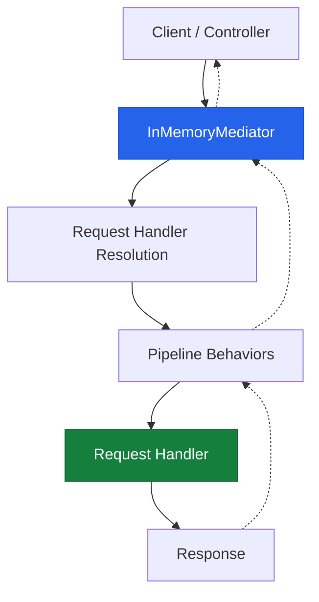
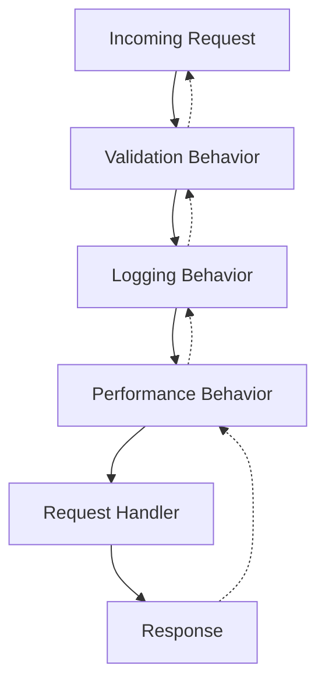
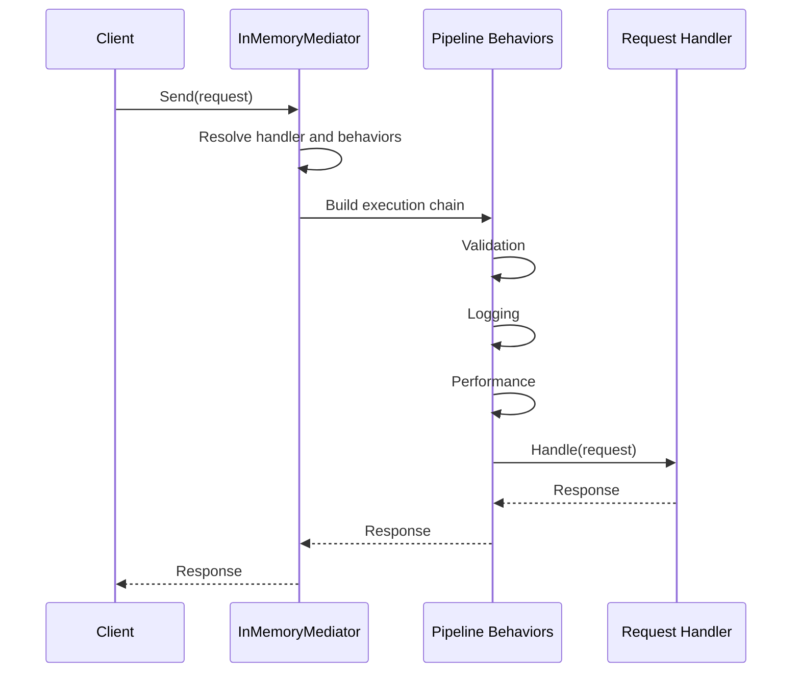

# ⚡ Fast Shop Microservices — Custom Native Mediator

<p align="center">
  <strong>Understanding the Mediator Pattern by Building It from Scratch in .NET</strong>
</p>

<p align="center">
  A hands-on implementation exploring Reflection, Open Generics, Dependency Injection, and Pipeline Behaviors — without relying on an external mediator library.
</p>

<p align="center">
  
  
  
  
</p>

---

## 📸 Project Overview

This project is part of **Fast Shop Microservices**, where I'm exploring how core architectural patterns work internally by implementing them with native .NET capabilities.

Instead of simply adding a mediator package and using its abstractions, the goal is to understand what happens behind the scenes:

- How are request handlers discovered?
- How does Dependency Injection resolve generic handlers?
- How can open generic pipeline behaviors be closed at runtime?
- How does a request travel through multiple behaviors before reaching its handler?
- How can requests with and without return values share the same execution flow?

The current focus is building a **Custom Native Mediator** that brings these concepts together.

<p align="center">
  
</p>

---

## 🏗️ How It Works

At a high level, the mediator acts as a central component between the sender and the request handler.

The sender doesn't need to know which handler processes the request. It only sends a request through the mediator, which resolves the appropriate handler and executes the configured pipeline.

### High-Level Architecture



### Request Execution Pipeline

Every request passes through the registered pipeline behaviors before reaching its handler.

For example:



The pipeline is built through **delegate chaining**. Each behavior receives the next delegate in the chain, allowing it to execute logic before and after the next component.

This creates a round-trip execution flow:

1. The request moves forward through the behaviors.
2. The handler processes the request.
3. The response travels back through the pipeline.

---

## 🔍 Core Technical Implementation

### 1. Assembly Scanning & Dependency Injection

The mediator uses Reflection to inspect assemblies and discover implementations of:

- `IRequestHandler<TRequest, TResponse>`
- `IPipelineBehavior<TRequest, TResponse>`

Discovered implementations are registered automatically in `IServiceCollection`.

This removes the need to manually register every handler and pipeline behavior.

### 2. Reflection & Open Generics

One of the more challenging parts is resolving generic types dynamically at runtime.

The implementation needs to distinguish between:

- **Open Generic Types:** Types that still contain generic parameters.
- **Closed Generic Types:** Types where all generic parameters have been specified.

A key part of this process is checking:

```csharp
type.ContainsGenericParameters
```

The mediator uses runtime type information to resolve open generic pipeline behaviors into the appropriate closed generic types, then invokes their `Handle` methods.

This is especially important because the actual request and response types are only known when a request is being processed.

### 3. Pipeline Behaviors & Delegate Chaining

Pipeline behaviors provide a way to execute reusable logic around request handlers.

The execution order can look like this:

| Stage | Responsibility |
|---|---|
| Validation | Validate the incoming request |
| Logging | Record request execution details |
| Performance | Measure execution duration |
| Handler | Execute the actual business logic |

The pipeline is composed dynamically using delegates, allowing each behavior to wrap the next execution step.

### 4. Supporting Requests With and Without Responses

Not every request needs to return a value.

To support both scenarios consistently, the implementation uses the `Unit` type to represent a request with no meaningful response.

This allows requests with a response and requests without one to follow a unified pipeline execution model.

---

## 🔄 Request Lifecycle — Sequence Diagram

The following diagram illustrates the interaction between the sender, mediator, pipeline behaviors, and handler.



---

## 🧩 Technical Concepts Explored

This implementation brings together several important .NET concepts:

| Concept | How It Is Used |
|---|---|
| Reflection | Discovering handlers and behaviors |
| Open Generics | Resolving generic pipeline components |
| Dependency Injection | Registering and resolving implementations |
| Delegate Chaining | Composing the request execution pipeline |
| Generic Interfaces | Defining reusable request and handler contracts |
| Unit Type | Supporting requests without a response |
| Runtime Type Resolution | Working with request-specific generic types |

### How the Pieces Fit Together


---

## 🖼️ Architecture & Implementation Visuals

The following visuals provide a closer look at the main ideas behind the implementation.

<p align="center">
  
</p>

<p align="center">
  
</p>

---

## 🎯 What This Implementation Focuses On

Rather than treating the mediator as a black box, this work focuses on understanding and implementing its internal mechanisms:

- Automatic discovery and registration of handlers.
- Runtime handling of open and closed generic types.
- Dynamic composition of pipeline behaviors.
- Consistent execution for requests with and without responses.
- Separation between request senders and request handlers.

These are the core building blocks currently being explored and implemented.

---

## 🚧 Project Status

**This project is still under development.**

The current focus is the custom native mediator implementation and its underlying mechanics. The repository will continue evolving as more parts of the Fast Shop Microservices project are developed.

The diagrams are intended to explain the current design concepts, not to claim that every planned feature is already complete.

---

## 💡 Why Build It From Scratch?

Using an existing library is often the practical choice, but implementing a simplified version from scratch provides a different kind of value.

It helps answer questions that are easy to overlook when working only with abstractions:

- What actually happens when `Send()` is called?
- How does the DI container resolve an open generic behavior?
- How are multiple behaviors composed into one execution pipeline?
- How does the mediator connect a request type to its handler?
- What happens to the response after the handler finishes?

Understanding these mechanisms makes it easier to reason about the frameworks and libraries we use in real-world applications.

---

## 🔗 Repository

**Fast Shop Microservices — Custom Native Mediator**

[View the source code on GitHub](https://github.com/AhmedAbdo1612/Fast-Shop-Microservices-with-Custom-Native-Mediator)

---

<p align="center">
  <strong>Built to understand the abstractions, not just use them.</strong>
</p>

<p align="center">
  If you find this implementation interesting, feel free to explore the code, share feedback, or open a discussion.
</p>
